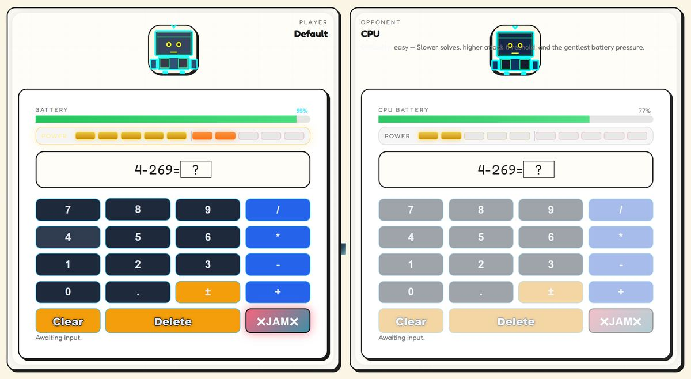

<picture>
  <source media="(prefers-color-scheme: dark)" srcset="assets/banner-dark.svg">
  
</picture>

  <a href="https://aufstin.me"><b>aufstin.me</b></a> &nbsp;·&nbsp;
  <a href="https://aufstin.me/resume/">resume</a> &nbsp;·&nbsp;
  <a href="https://aufstin.me/research/">research</a> &nbsp;·&nbsp;
  <a href="https://www.linkedin.com/in/filiko">linkedin</a> &nbsp;·&nbsp;
  <a href="https://calcul8r.app/demo"><b>play calcul8r 🔋</b></a>

I build agent systems that companies actually run on, and a math game where your calculator's battery is always dying. Biotech and CS by training, so AI in biology keeps pulling me back.

<table>
<tr>
<td width="50%" valign="top">

#### 🧠 &nbsp;Day job

**AI & Automation Lead, Nexus Agriscience.** The AI platform a 35-person company runs on: one MCP brain over five business systems, and agent coworkers across production, manufacturing, marketing, sales, accounting and coding.

</td>
<td width="50%" valign="top">

#### 🔋 &nbsp;Side quest

**[Calcul8r](https://calcul8r.app/demo)**, a 1v1 math battle in the browser. Both batteries drain every second. Solve to stall yours and build power, then **JAM** the other calculator's keys. First to 0% loses.

</td>
</tr>
</table>

### Receipts

<table>
<tr>
<td width="25%" align="center" valign="top"><h3>120 → 1,000+</h3>calls a day, handled by voice agents for a financial firm</td>
<td width="25%" align="center" valign="top"><h3>20–30s → 8–15s</h3>AI response time, with multi-model routing</td>
<td width="25%" align="center" valign="top"><h3>$6K / mo</h3>of paid integrations replaced by an agent order pipeline</td>
<td width="25%" align="center" valign="top"><h3>~54,000 → ~300</h3>legacy lineage records narrowed to links researchers can check</td>
</tr>
</table>

### 🔋 Calcul8r &nbsp;<a href="https://calcul8r.app/demo">play it, no account needed →</a>

Fill in the blank faster than the other calculator. Every correct answer pauses your drain and charges a unit of power; five power arms **JAM**, which locks random keys on your opponent's calculator until they solve six more. Play the CPU on Easy, Medium or Hard, or open a room for a friend. Pre-pre-alpha, and very much in progress.

### Things I've opened up

Pinned below 👇 [RailwayBot](https://github.com/filiko/RailwayBot) hands deploy failures to a coding agent · [EcoLiko](https://github.com/filiko/EcoLiko) estimates AI's energy, water and carbon footprint · [Breadcrumbs](https://github.com/MangosteenMadness/Breadcrumbs) is memory for an AI scientist (Rewiring Biology Hackathon by Owkin) · [testSieveSorter](https://github.com/filiko/testSieveSorter) is hackathon work on BioKEA's bug sorter, in CAD and MuJoCo.

<b>The longer story</b>

 

- **Nexus Agriscience**, AI & Automation Lead (May 2026 – now). Company brain over five business systems; a multi-agent engineering framework where coding agents ship changes and independent QA agents verify them against the running application; a CI/CD pipeline that turns tools employees build into org-wide features; AI-assisted genetics research tools.
- **Voski Digital**, Software Engineer, then AI Solutions Architect (Oct 2024 – Apr 2026). Voice agents, a conversational trading agent, multi-model routing, and a multi-agent harness that builds and maintains websites for about 20 retail clients. Led two engineers.
- **Corteva Agriscience**, R&D Intern, then Automation Engineer Co-op (2023–2024). Robotic laser-cut seals for screening plates, projected to save $450K a year in failed runs.
- **University of Houston**, B.S. Biotechnology & Computer Science (2025).

  
  
  
  
  
  
  
  

Bay Area · English & Spanish · yes, there's an F
